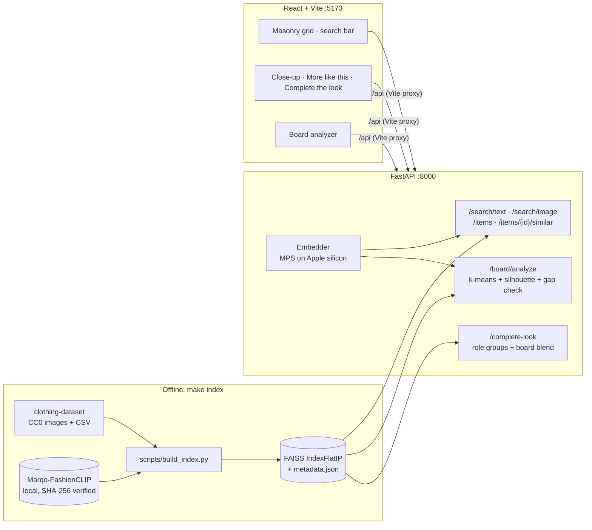

# MoodBoards

> **Disclaimer:** This is a non-commercial concept project and portfolio sample. It is not affiliated with, endorsed by, or sponsored by Pinterest. See [Disclaimer](#13-disclaimer).

## 1. Pitch

_One-line pitch: written once features 1–2 work._


### Run it locally

Prerequisites: [uv](https://docs.astral.sh/uv/), Node 20+, [Ollama](https://ollama.com).

```bash
make setup models index   # once: deps, local models, catalog index
make dev                  # API on :8000, web app on :5173
```

`make test` runs pytest and Vitest. `make help` lists every target.

## 2. User research and opportunities

_The full Problem | Evidence | My fix | Limits table is filled in as each feature lands._

### User wishes (anecdotal)

From an r/Pinterest thread where users listed their dream features ([link](https://www.reddit.com/r/Pinterest/comments/1tp1tkh/what_are_your_dream_features_on_pinterest/)). It's a handful of comments, not a survey, so I treat it as a signal, not proof.

| Wish (paraphrased) | Why it matters | My fix | Limits |
|---|---|---|---|
| Unlimited sub-boards inside boards | Big boards turn into a wall of images; one level of sections isn't enough for "Wedding → Guest outfits → Shoes" | Feature 8: nested sub-boards with no fixed depth limit, plus breadcrumbs | Deep nesting can get hard to navigate; the UI shows breadcrumbs and item counts per level |
| A color picker | People often remember an outfit by its color, not by a word for it | Feature 7: color picker in the search bar, ranked by perceptual color distance | Dominant colors come from the whole photo, so backgrounds can skew results |
| Seeing when a pin was made | Without a date, users can't tell old trends from new ones, or originals from reposts | Feature 6: a "first seen" date on the close-up, labeled with its source (photo metadata or ingestion time) | The catalog has no capture dates, so it shows ingestion time and says so |
| Saving one pin to several boards at once, like a checklist (a commenter said this used to exist) | Re-opening the save menu for each board is slow and breaks flow | Feature 8: checklist save to multiple boards in one action, with an undo toast | None beyond scope: it's a local demo with no accounts |

## 3. Prior art and what's different

_To be written._ The five differentiators:

1. Board-level taste: many images become a taste profile with distinct aesthetics
2. An agent that makes real tool calls, plus an eval harness
3. AI labels users can see and trust: evidence-based, visible on the grid, with an appeal path
4. Repost detection that credits the original creator
5. Group trip outfit planning: a shared aesthetic plus real weather become coordinated outfits and packing lists

## 4. Features and why

| # | Feature | Status |
|---|---|---|
| 0 | Scaffolding (FastAPI, React + Vite, Makefile, tests) | done |
| 1 | Indexing + image/text search | done |
| 2 | Board analysis (k-means, k by silhouette score) | done |
| 3 | Complete the look | done |
| 4 | Assistant (LangGraph + Ollama) | done (live run waits on model download) |
| 5 | AI labels from provenance metadata (light version: labels + explanations; no review queue or toggle) | done |
| 6 | Repost detection + original credit, "first seen" date on every item | done |
| 7 | Search by color (Lab k-means, Delta E 2000) | done |
| 7b | Mood picker: color wheel + aesthetic → curated items | done |
| 7c | Shop similar: outbound Google Shopping / Lens links from an item's real attributes | done |
| 2b | Character style boards: written style profiles of iconic film/TV looks → catalog matches | done |
| 8 | Checklist save to multiple boards, nested sub-boards, undo toast | done |
| 8b | Style-focus filter (Menswear / Womenswear / All) chosen in a first-visit welcome popup; estimated by CLIP zero-shot, labeled "estimated", ambiguous items count as unisex | done |
| 9 | Group trip outfit planning | done |
| 10 | Evals | done |

### 1. Visual and text search

**Problem.** People often know what they want only as a picture or a loose description ("oversized beige knit"). Keyword search can't connect either one to items whose metadata never uses those words.

**Approach.**
- Every catalog image is embedded once with Marqo-FashionCLIP, a CLIP model fine-tuned on fashion.
- Vectors are L2-normalized and stored in a FAISS `IndexFlatIP`, where inner product equals cosine similarity.
- Text queries and uploaded photos go through the same model, so either one can be compared directly with item images.
- "More like this" reuses each item's stored vector, so it needs no extra model call.

**Why this approach.**
- At about 5k items, exact search takes about a millisecond, so an approximate index (IVF or HNSW) would add recall loss and tuning for no benefit.
- Filtered searches (category, kids) simply scan everything and filter.
- I'd switch to IVF-PQ or HNSW above roughly 1M items.

**Honest "no match".** Vector search always returns *something*, so a clothing-only catalog would answer "birthday cake" with T-shirts as if they were good results. Text search therefore checks the mean score of its top 10 results. On the real index, 13 clothing queries scored 0.232–0.269, and 13 off-topic or gibberish queries scored 0.069–0.211. Below a cutoff of 0.22, the UI says the catalog is clothing only and offers "Show closest items anyway" instead of pretending. The cutoff came from those 26 queries, so feature 10 re-checks it on a held-out set.

**Model in its own process.** On macOS, `faiss-cpu` and PyTorch each bundle their own OpenMP runtime. With both in one process, building the model segfaulted, and the server later aborted with OpenMP's "Error #15". OpenMP's only escape hatch, `KMP_DUPLICATE_LIB_OK`, is documented as unsafe: it can silently return wrong results, which a search engine can't afford. So FashionCLIP runs in one spawned worker process and the API process keeps FAISS. They exchange images and vectors, and the two runtimes never meet. This mirrors how production systems split model serving from the vector index. On real data, the first query takes about 2.7 s while the model loads, and later queries take about 10 ms end to end.

**Alternatives considered.**
- General OpenAI CLIP. Rejected: FashionCLIP is trained on product images and attributes, which matches this domain better.
- A hosted vector database. Rejected: unnecessary at this scale, and it would break "runs locally with no API keys."

**Measured by.** Recall@10 on held-out same-category queries (feature 10).

### 2. Board analysis

**Problem.** Real boards mix looks: half "clean minimal" and half "70s suede." Averaging all their images produces a beige centroid that matches neither.

**Approach.**
1. Embed the 3–20 board images.
2. Run k-means for k = 2 and 3 (k-means++ init, 10 restarts) and score each split with the mean silhouette using cosine distance.
3. Keep the best split only if its silhouette is at least 0.15 **and** every pair of aesthetic centroids is at least 0.35 apart in cosine distance. Otherwise the board counts as one aesthetic. Both values come from a grid search on 240 synthetic boards (section 6).
4. For each aesthetic, return the top catalog matches for its centroid, plus the three closest words from a fixed style vocabulary, scored with the CLIP text encoder.

**Why the second check.** My first version used silhouette alone, and a unit test caught it splitting one very tight group with a silhouette of 0.67. Silhouette is scale-free: inside a tight cluster, random noise looks like structure. The centroid-gap rule asks the question that actually matters, "are these looks really different?"

**Alternatives considered.**
- scikit-learn's KMeans. Rejected for now: at 20 points, about 40 lines of numpy is enough, easy to read, and avoids another dependency.
- The elbow method. Rejected: it needs a human to read a plot.
- HDBSCAN. Rejected: unreliable with 3–20 points.

**Limits.**
- On synthetic boards, 66% of one-look boards are kept whole and 93% of two-look boards are split (section 6). One dataset category is only a proxy for "one look".
- Style words come from concrete garment phrases (see the mood picker), not a trained classifier.

### 3. Complete the look

**Problem.** "I love this jacket. What do I wear it with?"

**Approach.**
- Each of the dataset's 17 usable labels is mapped to an outfit role (tops, bottoms, one-piece, outerwear, shoes, hats). Each role has complementary roles; for example, a top pulls bottoms, shoes, outerwear and hats.
- Within each complementary role, items are ranked by similarity to the anchor item. If you came from a board aesthetic, the query is blended as 0.7 × item + 0.3 × board centroid.
- Suggestions match the anchor's real `kids` flag.

**Why this approach.** Pinterest's Complete the Look learns compatibility from scene images where items are worn together. This dataset has single-item photos only, so I use *shared style in embedding space* as a proxy: similar color, formality and texture. That's an honest limitation, and the README says so rather than claiming learned compatibility.

**Alternatives considered.** Training a compatibility model on Polyvore outfits. Rejected for now: the license is unclear and it's out of scope for a laptop demo.

**Measured by.** Rule checks in feature 10: no same-role suggestions, no kids/adult mixing, and the board blend should raise suggestions' similarity to the board centroid.

### 4. Style assistant

**Problem.** Some needs are questions, not queries: "what shoes would finish this look?" or "compare these two jackets." Chat assistants are also known to invent products.

**Approach.**
- An explicit LangGraph `StateGraph`: an `agent` node (qwen3:8b through Ollama, thinking mode off), a `tools` node, and a loop between them capped at 4 tool rounds.
- Four tools: `search_similar`, `complete_look`, `compare_items` (which adds a one-sentence visual description from the local qwen2.5vl vision model) and `describe_board`.
- The answer streams to the browser as Server-Sent Events: tool calls, tool results, tokens, then a final `done` event.

**Guardrail against invented products.**
- The model must cite products as `[item:ID]`.
- Every tool writes the IDs it returned into a per-turn ledger. After the model answers, `validate_answer` keeps only citations found in that ledger and strips everything else.
- Unit tests check that an invented ID is stripped, and also that a *real* catalog ID the model never looked up this turn is stripped.
- The UI renders cards only from the validated list, so a hallucinated product can't reach the screen even when its ID happens to exist.

**Graceful edges.**
- An off-topic request gets a short "I only help with outfits" reply, and no tools run.
- An empty or weak search returns `results: []` with a note, so the model says it found nothing instead of reaching for weak matches.
- If the model is unreachable, the UI shows "Is Ollama running?"

**Alternatives considered.**
- LangGraph's prebuilt ReAct agent. Rejected: an explicit graph makes the loop limit and the grounding step visible and testable.
- Asking the model for JSON output. Rejected: small local models break JSON more often than they break a simple citation marker.

**Measured by.** Feature 10's 15 test prompts check that tools were called, that every cited ID exists, and that no items were invented.

### 8. Saving: multi-board checklist, nested sub-boards, undo toast

**Problems.** Users asked to save one Pin to several boards at once, like a checklist they remember from before. They want boards inside boards. And they complained about pop-ups after saving or downloading (section 2).

**Approach.**
- **Hover Save** saves straight to your last-used board. The button reads "Save to Wedding" for screen readers.
- **The board name ("Wedding ⌄")** opens a checklist popover listing every board and sub-board, indented by depth and pre-checked where the item is already saved. Ticking several boards saves to all of them in one request. Unticking removes the item. "Create board" works inline.
- **Every save shows a toast** at the bottom with Undo for 5 seconds. Undo removes the item from exactly the boards *that* save added (the API returns `added_to`), so earlier saves are never touched.
- **No modal dialogs anywhere in the flow.** The picker is a non-modal popover that Escape or a click outside closes.
- **Boards nest to any depth** through a `parent_id` column. A recursive SQL query lists them in tree order, and board pages show breadcrumbs. Deleting a board cascades to its sub-boards and saves.

**Alternatives considered.** Pinterest-style "sections" with one level only. Rejected, because the user wish was explicitly "infinite sub-boards." A self-referencing table is just as simple and has no depth limit.

**Limits.** There's a single local user until feature 9 adds lightweight identity. Moving a board under a different parent isn't supported yet, which also means cycles can't happen.

### 7. Search by color

**Problem.** "Search by color" is one of the most-requested wishes in the user thread. People remember outfits as "that sage thing", and color words are fuzzy for both people and CLIP.

**Approach.**
- At index time, each image's center crop (60%, which skips most floor and wall) is downsampled to 40×40 and clustered with k-means **in CIE Lab**, a color space where distances roughly match perceived differences. 3–5 dominant colors are kept with their area weights.
- At query time, one vectorized **CIEDE2000** call scores all 5,163 items against the picked color. A small penalty for low-coverage colors stops a yellow button from making a navy shirt count as "yellow."
- Typing words alongside a color (sage + "linen") blends a normalized CLIP text score in at 40%.
- Every result carries its Delta E and the matched swatch, so the ranking can be explained.

**Why CIEDE2000 instead of RGB distance.** RGB distance overstates differences in blues and understates them in greens. CIEDE2000 is the industry standard for perceived difference. My implementation is checked against 12 published reference pairs from Sharma et al. (2005) to 4 decimal places.

**Measured by.** Feature 10: the mean Delta E of the top 20 results versus random items.

### 5. AI labels users can trust (light version)

**Problem.** AI images flood feeds, labels hide behind a click, and wrong labels stick to human-made work (section 2).

**Approach.**
- The label comes **only from provenance metadata**, never from pixels:
  - **AI-generated:** a valid C2PA (Content Credentials) manifest, or an IPTC `DigitalSourceType` tag, declares an AI source such as `trainedAlgorithmicMedia`.
  - **Human-made (verified):** a *validly signed* C2PA manifest declares `digitalCapture`. An unsigned IPTC claim of camera capture stays **Unknown**, because it's trivial to fake.
  - **Unknown:** the default, also used when a manifest fails validation, for example because the file was edited after signing.
- The label sits **on the grid card**. Unknown shows as a quiet "ⓘ" so it doesn't crowd the grid, and clicking any label explains which field was found, or that none was.
- **Uploads:** provenance is read from the *original bytes before* GPS is stripped and the image re-encoded. Re-encoding also drops the C2PA manifest, so this order is required. A test signs an image, strips it, and checks that the label survives while the stripped copy no longer carries the manifest.
- Tests generate a throwaway certificate authority and sign real C2PA manifests with `c2pa-python`. Every catalog photo is honestly Unknown: the dataset has no metadata at all.

**Scoped out (by choice).** The creator review queue, the reviewer page, and the "Fewer AI images" toggle from the original spec. The catalog has no AI-labeled images for a toggle to act on, and I prioritized search accuracy and trip planning instead. With Pinterest's platform, labels would come from Content Credentials at upload across all Pins, plus classifier signals feeding a human review queue (section 10).

### 6. Repost detection and original credit

**Problem.** Artists' work gets reposted without credit (section 2), and duplicate copies clutter results.

**Approach.**
- Every image gets a 64-bit perceptual hash (pHash). Its EXIF `DateTimeOriginal` is read before any conversion that could strip it, and its ingestion time is recorded.
- Two images count as the same picture if the signals agree: pHash within 12 bits **and** FashionCLIP cosine of at least 0.95; or, for heavily recompressed copies, pHash within 4 bits **and** cosine of at least 0.88 **and** main colors within Delta E 6.
- Duplicate groups collapse into one card. The card credits the copy with the single earliest timestamp, labeled with the date source ("EXIF DateTimeOriginal" or "ingestion time"). A tie, or a group with only ingestion times, says **"original unclear"** instead of picking one.
- Uploads always count as newer than catalog images. A photo search that matches a catalog image shows "This looks like a repost" and links to the original.
- "More like this" excludes the open item's own copies.

**How the thresholds were chosen.** I measured this rather than guessing ([report](evals/reports/repost_threshold.md)), using 300 real catalog photos, each transformed six ways, against 44,850 pairs of different photos:
- pHash ignores resizing, JPEG quality 20 and color shifts (≤ 4 bits), but it's fragile to cropping. A 5% crop per side moves a median of 12 bits, and a 10% crop moves 23, about as far as unrelated photos.
- My first placeholder (pHash ≤ 10 alone) would have chained **322 unrelated images** into one "repost" group through union-find. That's because this dataset's photos share one flat-lay layout, so *different* garments can hash within 2–4 bits. I confirmed this by viewing the closest pairs.
- Adding CLIP agreement fixes both problems. True copies score 0.97–0.999, look-alike different garments 0.58–0.89, and a 5% crop still scores a median of 0.97. With both signals, the 5,163-image catalog has exactly **3** duplicate groups, all genuine. One is the same photo labeled "Skirt" in one place and "Shorts" in another.

**Limits.**
- The dataset has no EXIF dates (0 of 5,756 files), so catalog-only groups honestly read "original unclear".
- Crops over about 10% can escape detection (57% recall at 5% per side). Overall recall across the four edit types is 84%, with 0 false matches (section 6).

### 9. Group trip outfit planning

**Problem.** Group trips get planned across several apps (itinerary, chat, shared albums), and none of them help with *what to wear together* (section 2).

**Approach.**
- **Trips:** a destination found with Open-Meteo geocoding, dates, and day or event slots ("Day 2 · beach dinner").
- **Sharing:** invite links with a 192-bit random token that's shown once and stored only as a SHA-256 hash. The owner can revoke links, and they expire after 1–30 days.
- **Roles:** owner, editor and viewer, checked by one helper on every endpoint. Non-members get **404**, not 403, so private trips can't be discovered.
- **Taste:** each member's inspiration photos are embedded (GPS stripped first, and only vectors and colors are stored, not the photos). The group's blended aesthetic is the mean of the *member* centroids, so each person counts equally however many photos they add. Each pair of members gets a similarity score, described in plain words from "very close" to "clashing".
- **Weather (Open-Meteo):** the forecast when the whole trip is within 16 days; otherwise **historical averages** of the same dates over the past 5 years from the archive API. There, "rain chance" is the share of those years with at least 1 mm. The source and the attribution are always shown.
- **Outfit planner (`plan_trip_outfits`):** blends the group's taste with the slot text ("an outfit for beach dinner"), then applies the weather rules:
  - Below 15°C: outerwear is added and shorts are removed.
  - At 27°C and above: no outerwear, and shorts, skirts and dresses are preferred.
  - When rain is likely (50% or more): open-toe shoes are excluded. The sandal cutoff was chosen by viewing all 431 catalog shoes ranked by "open-toe sandals" similarity: ranks 1 to about 97 are nearly all sandals. My first guess would have caught only one.
- **Coordinate for photos:** k-means over everyone's inspiration colors in Lab gives a shared palette, and suggestions re-rank toward it with Delta E 2000.
- **Collaboration:** thumbs up and down with "sort by votes"; an activity feed streamed over **Server-Sent Events**; a per-person **packing list** built from the pieces you liked plus weather essentials (umbrella, warm layer, sun protection); day-by-day notes, where assistant drafts are stored and shown as **"AI suggestion"** with a prompt that forbids prices, hours and bookings.
- **Publish:** a read-only `/t/<slug>` page with no sign-in. It shows the plan and the traveler count, with no names or personal info. The owner can unpublish, after which the page returns 404.

**Checked live.** Reykjavik four days out got the real forecast (9°C, 77–90% rain) and suggestions with outerwear and no shorts. Ninety days out it switched to historical averages (about 1°C) and labeled them.

**Limits.**
- Identity is a display name plus a cookie, with no passwords. Production would use real authentication.
- Rate limits are in-memory per user (10 invites a minute, 5 publishes a minute). Production would enforce them at the edge.
- The activity feed polls SQLite once a second, which is fine at this scale. Production would use a pub/sub system.

### Style focus: Menswear / Womenswear / All (8b)

**Problem.** A mixed catalog wastes people's time when half the results aren't what they shop for. But the dataset has **no gender field**, and many pieces are genuinely unisex.

**Approach.**
- Each item gets an estimated *lean*: its similarity to three "womenswear" prompts minus its similarity to three "menswear" prompts, using FashionCLIP.
- Items within ±0.01 of zero count as **unisex** and show under both. My first band (±0.03) shared 1,666 items between the views, so they looked alike. Now about 540 are shared, and rankings get a small boost toward the chosen focus. The top 12 now differ completely between Womenswear and Menswear in search, color, mood and For you.
- The first-visit welcome card asks "What should we show you?" A compact "Show" dropdown in the header changes it later.
- The filter applies to browsing, every search, More like this, Complete the look, the mood picker, character boards and board analysis.
- It defaults to "All styles", and the control's tooltip says the split is estimated.

**Checked on the real catalog.** Dresses, skirts, blouses and tops lean womenswear in 91–100% of cases. Polos, shirts and hats lean menswear in 63–72%. T-shirts, pants, shoes and hoodies straddle zero, which is honestly unisex. Womenswear shows 3,118 items, Menswear 2,584, and 539 appear in both.

**Why not a hard classifier.** A binary label would force unisex basics into one side and would present a guess as fact. The lean with a unisex band keeps uncertain items visible to everyone.

### Mood picker (7b)

**What it does.** Pick a color on a color wheel, then pick an aesthetic (for example minimalist, streetwear, or coastal). The app returns a curated grid of items that match both.

**Why it's here.** It's my own idea for when you know the *feeling* you want but not the words for it. Text search needs vocabulary like "sage linen co-ord", and browsing needs patience. Two taps on a wheel and a chip turn a vague mood into a concrete starting board. It also builds on the color-picker wish from the user thread in section 2.

**How it works.**
- Each item's dominant colors (feature 7) are scored against the picked color with Delta E 2000.
- The aesthetic is scored with the CLIP text encoder ("a minimalist outfit"), using the same style vocabulary that names board aesthetics in feature 2.
- The two scores are normalized and blended. A "color ↔ style" slider sets the weight, so you can lean toward one or the other.
- Each result shows its color match and its style match, so the curation can be explained, not just trusted.

**Alternatives considered.**
- Searching for the color name as text ("red minimalist outfit"). Rejected: CLIP's sense of color words is fuzzy, and a picked hex value is precise.
- A hard color filter. Rejected: it empties out results for unusual colors, whereas a blended ranking degrades gracefully.

**How it's measured (feature 10).**
- The mean Delta E of the top 20 results should be lower than for random items.
- The style match of the top 20 should be higher than for a color-only ranking.

### Shop similar (7c)

**What it does.** On an item's close-up, a "Shop similar" button opens Google Shopping in a new tab. The search query is built only from the item's real data: its dominant color's name and its category, for example "burgundy t-shirt". A second link opens Google Lens, where you can drop in the image yourself.

**Why it's here.** The catalog is an open dataset with no stores or prices, but finding something you can actually buy is the natural next step after "I love this."

**Why not show results inside the app.**
- Google has no free official API for Lens or Shopping results.
- Scraping Google breaks its terms and this project's no-scraping rule.
- Paid APIs break the no-paid-APIs rule.
- Catalog images live on localhost, which Google can't fetch.

So MoodBoards hands off to Google with a transparent query and never displays prices, stores, or availability it hasn't verified. The button says where it goes ("Opens Google Shopping in a new tab") and that results aren't checked by MoodBoards.

**Alternatives considered.**
- Google Cloud Vision Web Detection: paid after the free tier, and it needs an API key and a public image URL.
- SerpAPI: paid.
- Retailer affiliate feeds: out of scope, and they bring commercial terms.

### Character style boards (2b)

**What it does.** Pick an iconic film or TV character and get a board of catalog items in their signature style, built with the same pipeline as board analysis.

**How it works.**
- Each character is a short *written* style profile, labeled as an editorial interpretation. For example: "inspired by a 90s sitcom fashion icon: plaid mini skirts, fitted cardigans, knee-high socks."
- The profile's phrases are embedded with the CLIP text encoder and averaged into a style vector. Catalog items are ranked against it.
- The board shows which phrases each item matched best, so the match can be explained.

**What it deliberately doesn't do.**
- It shows no film stills, promo images, or photos of actors. Those are copyrighted, and using actors' likenesses raises right-of-publicity issues.
- The boards don't imply any studio endorsement.
- The profiles describe costume *style* in general terms. They aren't claims about specific garments, brands, or prices.

**Alternatives considered.** Embedding film stills. Rejected for the licensing reasons above, and because a still mixes the costume with lighting, set, and the actor.

Design rules decided up front:

- **Provenance before privacy stripping.** Uploads have their C2PA/IPTC provenance and EXIF `DateTimeOriginal` read and stored *before* any re-encoding or GPS removal. A test checks that a C2PA-signed upload keeps its label afterwards.
- **No guessing the original.** If duplicates share a timestamp, or only ingestion times are known, the card says "original unclear" instead of crediting one. Uploads always count as newer than catalog items.
- **Labels demo with real evidence.** A hand-labeled set (the author's phone photos and AI images carrying Content Credentials) is added in feature 5, so all three label states appear. Feature 10's eval reuses it.

### UI approach

The UI is based on the Pinterest website, so each feature can be judged as it would look inside Pinterest:
- a masonry grid of rounded cards with titles underneath and a Save button on hover
- a Pin-style close-up with the image on one side and actions and "More like this" on the other
- a settings-style side nav

Colors and corner rounding come from [Gestalt](https://github.com/pinterest/gestalt), Pinterest's open-source design system (Apache-2.0). The header shows Pinterest's logo only to present the concept, and it implies no affiliation (see the disclaimer). The project name, MoodBoards, is my own. Pinterest's proprietary "Pin Sans" font is not used; the app uses the same system-font fallback stack instead. One accessibility change from Gestalt: its focus ring is semi-transparent, so the app uses a solid ring of the same blue that meets the 3:1 contrast guideline.

**Light and dark mode.** Light is the default. The sun/moon button in the header switches modes, the choice is remembered, and a feature tip points it out.

**In-app feature tips.** The first time a feature appears, a small popover explains how to use it and why it exists. It doesn't block the page: Escape or "Got it" dismisses it, and the floating "?" button lists every tip again. Tips never appear after saving or downloading. That avoids the kind of interruption users complained about (see section 2).

## 5. Architecture



Planned additions (features 4–9): LangGraph agent with Ollama, SQLite for boards, saves, review queue and trips, provenance and pHash services, color index, Open-Meteo client, and SSE for trip activity.

## 6. Eval results

`make eval` writes a dated report; the latest is [evals/reports/latest.md](evals/reports/latest.md). Highlights from the full run (seed 7):

| Area | Result |
|---|---|
| Retrieval, 500 held-out photo queries | **Recall@10 98.0%**; precision@10 80.7% (same-category proxy) |
| "Nothing matched" cutoff, 24 new queries | 12/12 off-topic flagged; 10/12 clothing shown |
| Board analysis, 200 synthetic boards | 66% of one-look boards kept whole, 93% of two-look boards split (was 10% / 100% before tuning) |
| Color search | Top-20 mean Delta E **10.7** vs. 32.0 for random items |
| Mood picker | Style match of top 20: **0.91** vs. 0.15 for color-only |
| Repost detection | **84%** recall over 4 edit types; **0** false matches in 49,990 different-photo pairs |
| Trip weather rules | 100% on all 6 rules (outerwear when cold, no shorts, no open-toe in rain, no outerwear when hot, …) |
| Trip permissions | Viewer can't edit, revoked/expired links fail, unpublished page 404s: all pass |
| AI labels | 6/6 provenance cases (signed AI, signed capture, tampered, IPTC AI, unsigned capture claim, no metadata) |
| Assistant (15 prompts) | **Skipped until the local model is pulled**; reported as skipped, never faked |

**What the evals changed:**
- **Board thresholds.** The first guesses split 90% of one-category boards. A grid search on separate boards moved them to silhouette 0.15 and centroid gap 0.35.
- **Repost rule.** pHash plus CLIP alone caught only 12% of heavily recompressed copies, because their CLIP similarity drops to about 0.90. A second tier (pHash ≤ 4, CLIP ≥ 0.88, and main colors within Delta E 6) raised overall recall from 60% to 84% with no new false matches. I first tried a color limit of 15, but that let two different pairs of jeans through, so it's 6.
- **Sandal cutoff.** Viewing ranked shoes showed my first guess (0.24) would catch 1 shoe instead of about 97 sandals.

## 7. Security and privacy

_Summary of [THREAT_MODEL.md](THREAT_MODEL.md): features 5 and 9._

## 8. How I used AI tools and how I validated their output

_To be written in my own words._

## 9. Learning curve

_Pulled from [LEARNING_LOG.md](LEARNING_LOG.md), in my own words._

## 10. Limitations and next steps

### What I'd build with access to Pinterest's platform

Some features are built here in a reduced but honest form, because the full version needs data or partnerships only Pinterest has. If I had that access, here's what each would become:

| Feature | What this demo does | With Pinterest's platform |
|---|---|---|
| Shop similar (7c) | Opens Google Shopping or Lens in a new tab with a query built from the item's color and category | In-app shoppable results from Pinterest's product catalog and merchant feeds, with real prices and stock, ranked by the same visual embedding |
| Complete the look (3) | Uses shared style in embedding space as a stand-in for "goes together" | A compatibility model trained on scene Pins where items are worn together, as in Pinterest's Complete the Look research |
| Character style boards (2b) | Written style profiles, no images | Licensed stills or official costume boards through studio partnerships, plus creator-made "get the look" Pins |
| "First seen" dates (6) | EXIF capture date or ingestion time, labeled with which one was used | Real Pin creation times and repin lineage, which make repost credit far more reliable |
| AI labels (5) | Reads C2PA and IPTC metadata on images I supply | Labels applied at upload across all Pins, plus Pinterest's own classifier signals feeding the review queue |
| Board analysis (2) | 3–20 uploaded images | Users' existing boards, sections, and engagement history |

### Current limitations

- **Board-split thresholds are loose on real data.** In a first end-to-end run, 4 shoe and 4 dress photos split cleanly. But 6 random T-shirts were also split into 2 "aesthetics" (silhouette 0.19), because FashionCLIP vectors for clothing all sit fairly close together. Feature 10's evals will tune both thresholds on real boards.
- **Category labels are coarse.** "denim jacket" returns blazers and shirts because the dataset has no denim or jacket-type labels. Retrieval is by image style only.
- **Card titles are category names** ("T-Shirt"), because the dataset has no product names, and the app doesn't invent them.

## 11. Sources

_Grouped list with one line each on what it informed. Short and mirror links will be replaced with canonical URLs. Dataset, model, API, and library licenses are recorded in [DATA.md](DATA.md)._

## 12. Where this fits in Pinterest

_Feature-to-surface mapping: written once features are built._

## 13. Disclaimer

This is a non-commercial concept project built as a portfolio sample. It is not affiliated with, endorsed by, or sponsored by Pinterest. "Pinterest" and the Pinterest logo are trademarks of Pinterest, Inc. They appear only to describe the problems this project explores and to present the concept in context. The UI is based on the Pinterest website and uses colors and rounding values from Gestalt, Pinterest's open-source design system (Apache-2.0). The features and code are my own.
