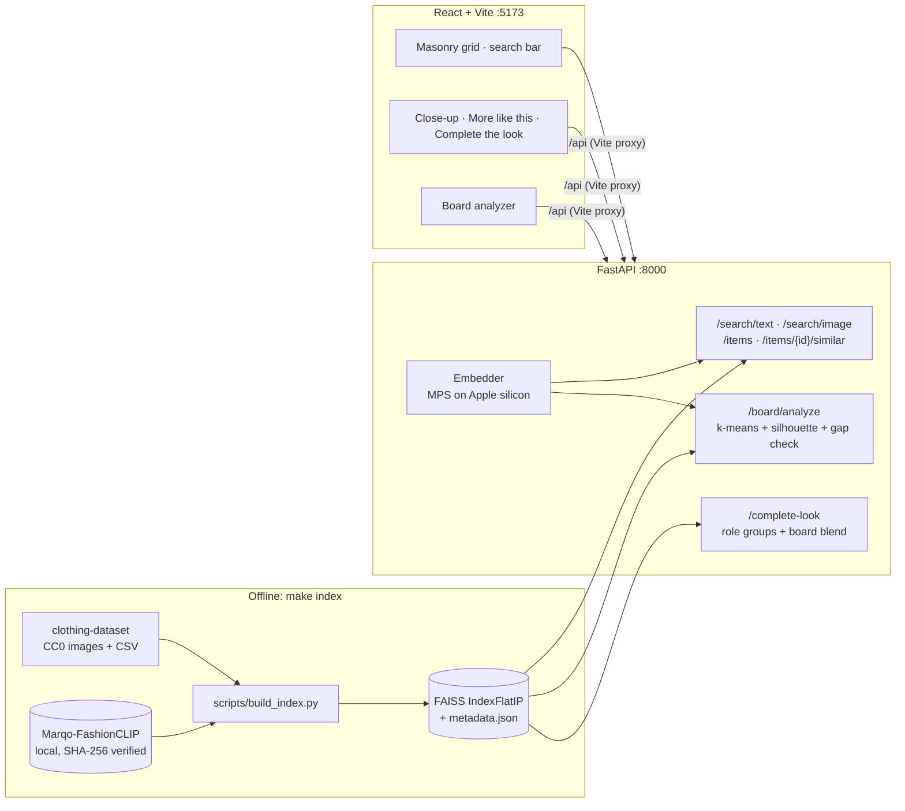

# MoodBoards

> **Disclaimer:** This is a non-commercial concept project and portfolio sample. It is not affiliated with, endorsed by, or sponsored by Pinterest. See [Disclaimer](#13-disclaimer).

## 1. Pitch

_One-line pitch: written once features 1–2 work._


### Run it locally

Prerequisites: [uv](https://docs.astral.sh/uv/), Node 20+, [Ollama](https://ollama.com).

```bash
make setup models index   # once: deps, local models, catalog index
make dev                  # API on :8000, web app on :5173
```

`make test` runs pytest and Vitest. `make help` lists every target.

## 2. User research and opportunities

_The full Problem | Evidence | My fix | Limits table is filled in as each feature lands._

### User wishes (anecdotal)

From an r/Pinterest thread where users listed their dream features ([link](https://www.reddit.com/r/Pinterest/comments/1tp1tkh/what_are_your_dream_features_on_pinterest/)). It's a handful of comments, not a survey, so I treat it as a signal, not proof.

| Wish (paraphrased) | Why it matters | My fix | Limits |
|---|---|---|---|
| Unlimited sub-boards inside boards | Big boards turn into a wall of images; one level of sections isn't enough for "Wedding → Guest outfits → Shoes" | Feature 8: nested sub-boards with no fixed depth limit, plus breadcrumbs | Deep nesting can get hard to navigate; the UI shows breadcrumbs and item counts per level |
| A color picker | People often remember an outfit by its color, not by a word for it | Feature 7: color picker in the search bar, ranked by perceptual color distance | Dominant colors come from the whole photo, so backgrounds can skew results |
| Seeing when a pin was made | Without a date, users can't tell old trends from new ones, or originals from reposts | Feature 6: a "first seen" date on the close-up, labeled with its source (photo metadata or ingestion time) | The catalog has no capture dates, so it shows ingestion time and says so |
| Saving one pin to several boards at once, like a checklist (a commenter said this used to exist) | Re-opening the save menu for each board is slow and breaks flow | Feature 8: checklist save to multiple boards in one action, with an undo toast | None beyond scope: it's a local demo with no accounts |

## 3. Prior art and what's different

_To be written._ The five differentiators:

1. Board-level taste: many images become a taste profile with distinct aesthetics
2. An agent that makes real tool calls, plus an eval harness
3. AI labels users can see and trust: evidence-based, visible on the grid, with an appeal path
4. Repost detection that credits the original creator
5. Group trip outfit planning: a shared aesthetic plus real weather become coordinated outfits and packing lists

## 4. Features and why

| # | Feature | Status |
|---|---|---|
| 0 | Scaffolding (FastAPI, React + Vite, Makefile, tests) | done |
| 1 | Indexing + image/text search | done |
| 2 | Board analysis (k-means, k by silhouette score) | done |
| 3 | Complete the look | done |
| 4 | Assistant (LangGraph + Ollama) | planned |
| 5 | AI labels, review queue, "Fewer AI images" toggle | planned |
| 6 | Repost detection + original credit, "first seen" date on every item | planned |
| 7 | Search by color (Lab k-means, Delta E 2000) | planned |
| 7b | Mood picker: color wheel + aesthetic → curated items | planned |
| 7c | Shop similar: outbound Google Shopping / Lens links from an item's real attributes | planned |
| 2b | Character style boards: written style profiles of iconic film/TV looks → catalog matches | planned |
| 8 | Checklist save to multiple boards, nested sub-boards, undo toast | planned |
| 9 | Group trip outfit planning (stretch) | planned |
| 10 | Evals | planned |

### 1. Visual and text search

**Problem.** People often know what they want only as a picture or a loose description ("oversized beige knit"). Keyword search can't connect either one to items whose metadata never uses those words.

**Approach.**
- Every catalog image is embedded once with Marqo-FashionCLIP, a CLIP model fine-tuned on fashion.
- Vectors are L2-normalized and stored in a FAISS `IndexFlatIP`, where inner product equals cosine similarity.
- Text queries and uploaded photos go through the same model, so either one can be compared directly with item images.
- "More like this" reuses each item's stored vector, so it needs no extra model call.

**Why this approach.**
- At about 5k items, exact search takes about a millisecond, so an approximate index (IVF or HNSW) would add recall loss and tuning for no benefit.
- Filtered searches (category, kids) simply scan everything and filter.
- I'd switch to IVF-PQ or HNSW above roughly 1M items.

**Honest "no match".** Vector search always returns *something*, so a clothing-only catalog would answer "birthday cake" with T-shirts as if they were good results. Text search therefore checks the mean score of its top 10 results. On the real index, 13 clothing queries scored 0.232–0.269, and 13 off-topic or gibberish queries scored 0.069–0.211. Below a cutoff of 0.22, the UI says the catalog is clothing only and offers "Show closest items anyway" instead of pretending. The cutoff came from those 26 queries, so feature 10 re-checks it on a held-out set.

**Model in its own process.** On macOS, `faiss-cpu` and PyTorch each bundle their own OpenMP runtime. With both in one process, building the model segfaulted, and the server later aborted with OpenMP's "Error #15". OpenMP's only escape hatch, `KMP_DUPLICATE_LIB_OK`, is documented as unsafe: it can silently return wrong results, which a search engine can't afford. So FashionCLIP runs in one spawned worker process and the API process keeps FAISS. They exchange images and vectors, and the two runtimes never meet. This mirrors how production systems split model serving from the vector index. On real data, the first query takes about 2.7 s while the model loads, and later queries take about 10 ms end to end.

**Alternatives considered.**
- General OpenAI CLIP. Rejected: FashionCLIP is trained on product images and attributes, which matches this domain better.
- A hosted vector database. Rejected: unnecessary at this scale, and it would break "runs locally with no API keys."

**Measured by.** Recall@10 on held-out same-category queries (feature 10).

### 2. Board analysis

**Problem.** Real boards mix looks: half "clean minimal" and half "70s suede." Averaging all their images produces a beige centroid that matches neither.

**Approach.**
1. Embed the 3–20 board images.
2. Run k-means for k = 2 and 3 (k-means++ init, 10 restarts) and score each split with the mean silhouette using cosine distance.
3. Keep the best split only if its silhouette is at least 0.1 **and** every pair of aesthetic centroids is at least 0.1 apart in cosine distance. Otherwise the board counts as one aesthetic.
4. For each aesthetic, return the top catalog matches for its centroid, plus the three closest words from a fixed style vocabulary, scored with the CLIP text encoder.

**Why the second check.** My first version used silhouette alone, and a unit test caught it splitting one very tight group with a silhouette of 0.67. Silhouette is scale-free: inside a tight cluster, random noise looks like structure. The centroid-gap rule asks the question that actually matters, "are these looks really different?"

**Alternatives considered.**
- scikit-learn's KMeans. Rejected for now: at 20 points, about 40 lines of numpy is enough, easy to read, and avoids another dependency.
- The elbow method. Rejected: it needs a human to read a plot.
- HDBSCAN. Rejected: unreliable with 3–20 points.

**Limits.**
- Both thresholds are starting points. Feature 10's evals check them against real boards.
- Style words are hints from a fixed list, not a trained classifier.

### 3. Complete the look

**Problem.** "I love this jacket. What do I wear it with?"

**Approach.**
- Each of the dataset's 17 usable labels is mapped to an outfit role (tops, bottoms, one-piece, outerwear, shoes, hats). Each role has complementary roles; for example, a top pulls bottoms, shoes, outerwear and hats.
- Within each complementary role, items are ranked by similarity to the anchor item. If you came from a board aesthetic, the query is blended as 0.7 × item + 0.3 × board centroid.
- Suggestions match the anchor's real `kids` flag.

**Why this approach.** Pinterest's Complete the Look learns compatibility from scene images where items are worn together. This dataset has single-item photos only, so I use *shared style in embedding space* as a proxy: similar color, formality and texture. That's an honest limitation, and the README says so rather than claiming learned compatibility.

**Alternatives considered.** Training a compatibility model on Polyvore outfits. Rejected for now: the license is unclear and it's out of scope for a laptop demo.

**Measured by.** Rule checks in feature 10: no same-role suggestions, no kids/adult mixing, and the board blend should raise suggestions' similarity to the board centroid.

### Mood picker (7b)

**What it does.** Pick a color on a color wheel, then pick an aesthetic (for example minimalist, streetwear, or coastal). The app returns a curated grid of items that match both.

**Why it's here.** It's my own idea for when you know the *feeling* you want but not the words for it. Text search needs vocabulary like "sage linen co-ord", and browsing needs patience. Two taps on a wheel and a chip turn a vague mood into a concrete starting board. It also builds on the color-picker wish from the user thread in section 2.

**How it works.**
- Each item's dominant colors (feature 7) are scored against the picked color with Delta E 2000.
- The aesthetic is scored with the CLIP text encoder ("a minimalist outfit"), using the same style vocabulary that names board aesthetics in feature 2.
- The two scores are normalized and blended. A "color ↔ style" slider sets the weight, so you can lean toward one or the other.
- Each result shows its color match and its style match, so the curation can be explained, not just trusted.

**Alternatives considered.**
- Searching for the color name as text ("red minimalist outfit"). Rejected: CLIP's sense of color words is fuzzy, and a picked hex value is precise.
- A hard color filter. Rejected: it empties out results for unusual colors, whereas a blended ranking degrades gracefully.

**How it's measured (feature 10).**
- The mean Delta E of the top 20 results should be lower than for random items.
- The style match of the top 20 should be higher than for a color-only ranking.

### Shop similar (7c)

**What it does.** On an item's close-up, a "Shop similar" button opens Google Shopping in a new tab. The search query is built only from the item's real data: its dominant color's name and its category, for example "burgundy t-shirt". A second link opens Google Lens, where you can drop in the image yourself.

**Why it's here.** The catalog is an open dataset with no stores or prices, but finding something you can actually buy is the natural next step after "I love this."

**Why not show results inside the app.**
- Google has no free official API for Lens or Shopping results.
- Scraping Google breaks its terms and this project's no-scraping rule.
- Paid APIs break the no-paid-APIs rule.
- Catalog images live on localhost, which Google can't fetch.

So MoodBoards hands off to Google with a transparent query and never displays prices, stores, or availability it hasn't verified. The button says where it goes ("Opens Google Shopping in a new tab") and that results aren't checked by MoodBoards.

**Alternatives considered.**
- Google Cloud Vision Web Detection: paid after the free tier, and it needs an API key and a public image URL.
- SerpAPI: paid.
- Retailer affiliate feeds: out of scope, and they bring commercial terms.

### Character style boards (2b)

**What it does.** Pick an iconic film or TV character and get a board of catalog items in their signature style, built with the same pipeline as board analysis.

**How it works.**
- Each character is a short *written* style profile, labeled as an editorial interpretation. For example: "inspired by a 90s sitcom fashion icon: plaid mini skirts, fitted cardigans, knee-high socks."
- The profile's phrases are embedded with the CLIP text encoder and averaged into a style vector. Catalog items are ranked against it.
- The board shows which phrases each item matched best, so the match can be explained.

**What it deliberately doesn't do.**
- It shows no film stills, promo images, or photos of actors. Those are copyrighted, and using actors' likenesses raises right-of-publicity issues.
- The boards don't imply any studio endorsement.
- The profiles describe costume *style* in general terms. They aren't claims about specific garments, brands, or prices.

**Alternatives considered.** Embedding film stills. Rejected for the licensing reasons above, and because a still mixes the costume with lighting, set, and the actor.

Design rules decided up front:

- **Provenance before privacy stripping.** Uploads have their C2PA/IPTC provenance and EXIF `DateTimeOriginal` read and stored *before* any re-encoding or GPS removal. A test checks that a C2PA-signed upload keeps its label afterwards.
- **No guessing the original.** If duplicates share a timestamp, or only ingestion times are known, the card says "original unclear" instead of crediting one. Uploads always count as newer than catalog items.
- **Labels demo with real evidence.** A hand-labeled set (the author's phone photos and AI images carrying Content Credentials) is added in feature 5, so all three label states appear. Feature 10's eval reuses it.

### UI approach

The UI is based on the Pinterest website, so each feature can be judged as it would look inside Pinterest:
- a masonry grid of rounded cards with titles underneath and a Save button on hover
- a Pin-style close-up with the image on one side and actions and "More like this" on the other
- a settings-style side nav

Colors and corner rounding come from [Gestalt](https://github.com/pinterest/gestalt), Pinterest's open-source design system (Apache-2.0). The header shows Pinterest's logo only to present the concept, and it implies no affiliation (see the disclaimer). The project name, MoodBoards, is my own. Pinterest's proprietary "Pin Sans" font is not used; the app uses the same system-font fallback stack instead. One accessibility change from Gestalt: its focus ring is semi-transparent, so the app uses a solid ring of the same blue that meets the 3:1 contrast guideline.

**Light and dark mode.** Light is the default. The sun/moon button in the header switches modes, the choice is remembered, and a feature tip points it out.

**In-app feature tips.** The first time a feature appears, a small popover explains how to use it and why it exists. It doesn't block the page: Escape or "Got it" dismisses it, and the floating "?" button lists every tip again. Tips never appear after saving or downloading. That avoids the kind of interruption users complained about (see section 2).

## 5. Architecture



Planned additions (features 4–9): LangGraph agent with Ollama, SQLite for boards, saves, review queue and trips, provenance and pHash services, color index, Open-Meteo client, and SSE for trip activity.

## 6. Eval results

_Feature 10._

## 7. Security and privacy

_Summary of [THREAT_MODEL.md](THREAT_MODEL.md): features 5 and 9._

## 8. How I used AI tools and how I validated their output

_To be written in my own words._

## 9. Learning curve

_Pulled from [LEARNING_LOG.md](LEARNING_LOG.md), in my own words._

## 10. Limitations and next steps

### What I'd build with access to Pinterest's platform

Some features are built here in a reduced but honest form, because the full version needs data or partnerships only Pinterest has. If I had that access, here's what each would become:

| Feature | What this demo does | With Pinterest's platform |
|---|---|---|
| Shop similar (7c) | Opens Google Shopping or Lens in a new tab with a query built from the item's color and category | In-app shoppable results from Pinterest's product catalog and merchant feeds, with real prices and stock, ranked by the same visual embedding |
| Complete the look (3) | Uses shared style in embedding space as a stand-in for "goes together" | A compatibility model trained on scene Pins where items are worn together, as in Pinterest's Complete the Look research |
| Character style boards (2b) | Written style profiles, no images | Licensed stills or official costume boards through studio partnerships, plus creator-made "get the look" Pins |
| "First seen" dates (6) | EXIF capture date or ingestion time, labeled with which one was used | Real Pin creation times and repin lineage, which make repost credit far more reliable |
| AI labels (5) | Reads C2PA and IPTC metadata on images I supply | Labels applied at upload across all Pins, plus Pinterest's own classifier signals feeding the review queue |
| Board analysis (2) | 3–20 uploaded images | Users' existing boards, sections, and engagement history |

### Current limitations

- **Board-split thresholds are loose on real data.** In a first end-to-end run, 4 shoe and 4 dress photos split cleanly. But 6 random T-shirts were also split into 2 "aesthetics" (silhouette 0.19), because FashionCLIP vectors for clothing all sit fairly close together. Feature 10's evals will tune both thresholds on real boards.
- **Category labels are coarse.** "denim jacket" returns blazers and shirts because the dataset has no denim or jacket-type labels. Retrieval is by image style only.
- **Card titles are category names** ("T-Shirt"), because the dataset has no product names, and the app doesn't invent them.

## 11. Sources

_Grouped list with one line each on what it informed. Short and mirror links will be replaced with canonical URLs. Dataset, model, API, and library licenses are recorded in [DATA.md](DATA.md)._

## 12. Where this fits in Pinterest

_Feature-to-surface mapping: written once features are built._

## 13. Disclaimer

This is a non-commercial concept project built as a portfolio sample. It is not affiliated with, endorsed by, or sponsored by Pinterest. "Pinterest" and the Pinterest logo are trademarks of Pinterest, Inc. They appear only to describe the problems this project explores and to present the concept in context. The UI is based on the Pinterest website and uses colors and rounding values from Gestalt, Pinterest's open-source design system (Apache-2.0). The features and code are my own.
